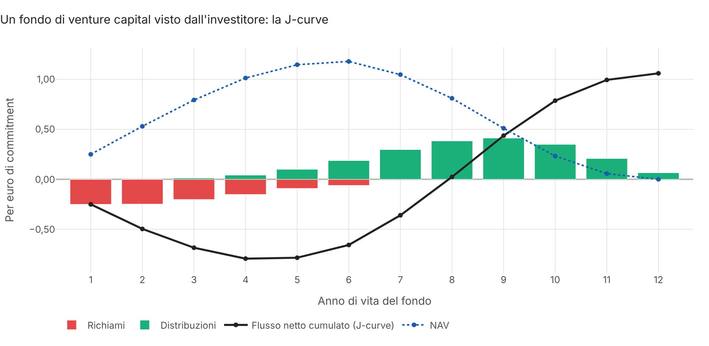
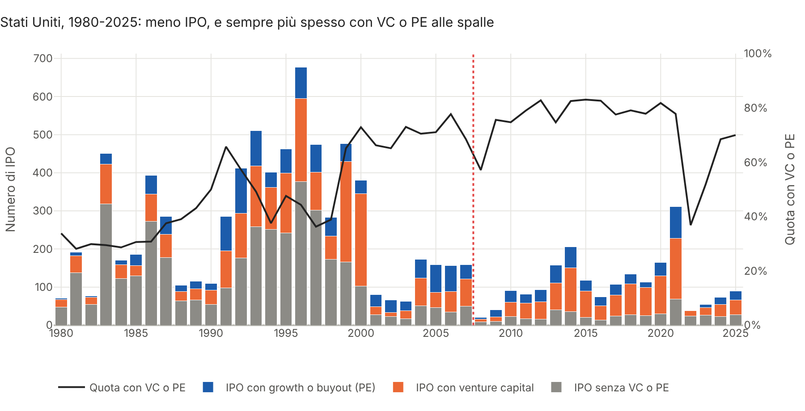
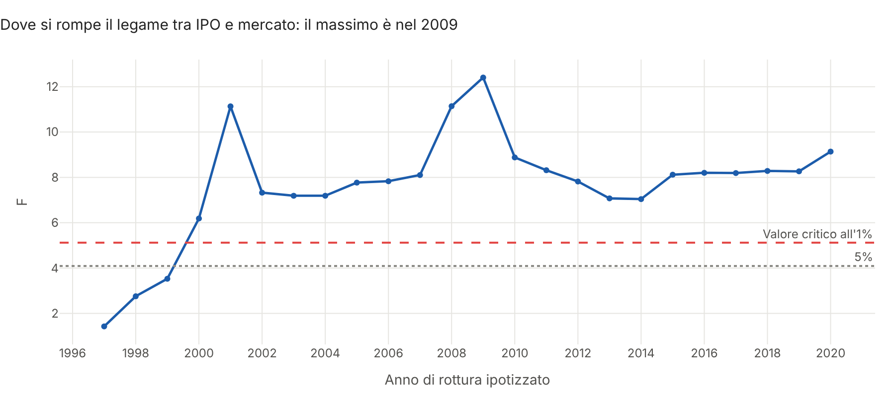
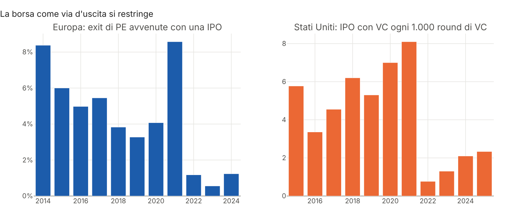

# Venture IPO Lab

**Dalla start-up alla quotazione, in Python: cap table e round, liquidation preference, valutazione, portafogli
angel, fondi di venture capital e un'analisi empirica, su dati pubblici reali, del legame tra private
market e IPO.**

Chi investe in una start-up deve rispondere a domande che un foglio Excel gestisce male. **Se la società viene
venduta, quanto riceve davvero ciascun socio? Quanto vale oggi un'azienda senza utili? Quante start-up servono per
non perdere capitale? Conviene passare da un fondo, e quanto tempo serve per vedere i soldi tornare?** E una domanda
più grande, da cui il progetto è partito: **l'abbondanza di capitale privato tiene le aziende lontane dalla borsa?**
Il risultato è un **report HTML interattivo** che segue un investimento dalla prima firma di un business angel fino
all'eventuale IPO.


## Da dove nasce

L'ultima sezione riprende e sviluppa la mia tesi di laurea magistrale in Banking & Finance all'USI (Università
della Svizzera italiana, 2019): *"Consequences of Venture Capital and Private Equity activities over the Initial
Public Offering procedures"*. La tesi misurava su quarant'anni di dati, in Europa occidentale e negli Stati Uniti,
il legame tra l'attività di VC e PE e il mercato delle IPO, con regressioni lineari semplici su 20 e su 10 anni.
Le conclusioni indicavano come passo successivo una regressione multivariata con i test F: questo progetto fa quel
passo e aggiunge il resto della catena, dal round seed all'exit.

I temi del progetto (venture capital, start-up dalla fase angel alla pre-IPO, accesso alla quotazione) sono gli
stessi su cui mi confronto in **Akka Italy**. Il progetto non usa dati, operazioni o partecipazioni di Akka Italy:
la start-up del caso dimostrativo è inventata, le serie sulle IPO sono dati pubblici citati con la fonte.

## Cosa fa

| Area | Contenuto |
|---|---|
| **Cap table** | Fondatori, **SAFE post-money** con cap e sconto, round priced, **option pool shuffle** (il pool richiesto dagli investitori entra nel pre-money), quote fully diluted round per round |
| **Waterfall** | Liquidation preference 1x o più, **partecipanti e non**, tetto alla partecipazione, seniority *stacked* o *pari passu*; la scelta di convertire è un equilibrio tra le classi; soglia di conversione di ogni classe |
| **Valutazione** | **Metodo VC** (exit, multiplo o TIR obiettivo, diluizione futura) con tabella di sensitività, **First Chicago** sugli scenari di exit |
| **Portafoglio angel** | Rendimenti a **legge di potenza** (Beta per le perdite, Pareto troncata per i successi), simulazione Monte Carlo per 1-100 start-up, probabilità di perdita e di trovare una *fund returner*, concentrazione dei proventi, riserva per i **follow-on** |
| **Fondo VC** | Flussi di **Takahashi-Alexander** (Yale), **J-curve**, TVPI, DPI, RVPI, TIR, **PME di Kaplan-Schoar**, scenari per quartile, **piano di commitment** per arrivare a un'allocazione obiettivo |
| **IPO e private market (dati reali)** | Serie pubbliche 1980-2025 su IPO negli Stati Uniti, condizioni di mercato e attività di VC e PE in USA ed Europa; **replica** delle regressioni della tesi; **regressione multivariata** con tassi, valutazioni, volatilità e rendimento di borsa (Newey-West); **test F**; **test di Chow** e **sup-F** di Quandt e Andrews; età alla quotazione; **underpricing**; la borsa come via d'uscita |
| **Dati propri** | Le stesse analisi su un proprio export (per esempio Bloomberg, più regioni) e su un campione di singole IPO: underpricing e rendimento a 3 anni con e senza VC o PE |
| **Report** | HTML in italiano con 14 grafici interattivi Plotly, tabelle e note di metodo |

Regressioni con `statsmodels`, simulazioni con `numpy`, test con `scipy`, grafici `plotly`, report `jinja2`.

## Avvio rapido

```bash
git clone https://github.com/Torraf-MI/venture-ipo-lab.git
cd venture-ipo-lab
pip install -e ".[png]"

# Report sul caso dimostrativo
venture-ipo-lab --demo

# Il proprio caso: fondatori, SAFE, round e scenari di exit in un file JSON
venture-ipo-lab --caso esempi/startup_demo.json --patrimonio 2000000 --allocazione 0.05

# In più, le analisi su dati propri (qui i file di esempio, sintetici, con lo stesso formato di un export)
venture-ipo-lab --demo --serie data/serie_esempio.csv --ipo data/ipo_esempio.csv --offline --grafici output/grafici
```

Il report viene salvato in `output/report.html` (con `--offline` funziona anche senza connessione, con
`--grafici cartella` salva anche i PNG). Un esempio già generato: [`docs/report_esempio.html`](docs/report_esempio.html).

Le serie pubbliche reali sono incluse nel pacchetto ([`dati_pubblici/`](src/venture_ipo_lab/dati_pubblici/), fonti
e termini d'uso in [`FONTI.md`](src/venture_ipo_lab/dati_pubblici/FONTI.md)). I formati dei CSV per i dati propri
sono descritti in [`dati.py`](src/venture_ipo_lab/dati.py) e negli esempi in [`data/`](data/):
una riga per anno e regione per le serie (`anno, regione, ipo, ipo_raccolta, ipo_vc, ipo_pe, operazioni_private,
capitale_privato, eta_mediana_ipo, tasso_10a, valutazione, volatilita`) e una riga per IPO per il campione
(`anno, regione, backing, eta, raccolta, underpricing, rendimento_3a, mercato_3a`).

## Uso come libreria

```python
from venture_ipo_lab import CapTable, distribuisci, metodo_vc, simula_portafogli, flussi_fondo, indicatori
from venture_ipo_lab import empirico

ct = CapTable.fondazione({"Fondatrice": 0.6, "Fondatore": 0.4})
ct.safe("Business angel", 200_000, cap=2_500_000, sconto=0.2)
ct.round("Seed", 3_500_000, {"Fondo seed": 1_000_000}, pool_post=0.10)
ct.round("Serie A", 12_000_000, {"Fondo VC": 4_000_000}, pool_post=0.12, partecipante=True, cap_partecipazione=3)
print(ct.diluizione())                    # quote dopo ogni passaggio
print(distribuisci(ct, 20_000_000))       # chi riceve cosa con una vendita a 20 milioni

print(metodo_vc(150e6, 4e6, tir_target=0.40, anni=6, diluizioni_future=[0.2, 0.15]).come_serie())
print(simula_portafogli([5, 20, 50]))     # rischio di perdita e numero di start-up
print(indicatori(flussi_fondo()))         # TVPI, DPI, TIR del fondo

e = empirico.analizza()                   # dati pubblici reali 1980-2025
print(e.tabella_tesi())                   # le regressioni semplici della tesi
print(e.multivariata.tabella(), e.f_mercati_privati, e.chow_2008, e.rottura["anno"])
```

Esempio completo in [`examples/esempio.py`](examples/esempio.py).

## Risultati sul caso dimostrativo

Una start-up software inventata: due fondatori, un business angel con un SAFE da 250.000 € (cap 3 milioni), un
seed da 1,2 milioni, una Serie A da 5,5 milioni e una Serie B da 18 milioni con preference partecipante e tetto 3x.

**I fondatori possiedono il 31% delle azioni, ma non il 31% dei proventi.** In una vendita a 40 milioni, sotto il
post-money della Serie B, le preference passano davanti e ai fondatori va il 15% del prezzo. Il fondo della Serie B
recupera i 18 milioni e partecipa al resto. La quota dei proventi raggiunge quella azionaria solo quando ogni classe
preferisce convertire: per la Serie B, sopra 219 milioni.


**Valutazione.** Con il metodo VC, un'exit da 220 milioni, un obiettivo del 40% annuo su 6 anni (7,5x) e il 36% di
diluizione futura, chi investe 5,5 milioni deve chiedere il 29,5% (pre-money 13,1 milioni). Il First Chicago sui
quattro scenari, dal fallimento alla quotazione, dà un valore di 22,8 milioni.

**Portafoglio angel.** Nel modello il miglior 10% degli investimenti fa il 45% dei proventi. Con 10 start-up la
probabilità di perdere capitale è del 50%, con 50 del 33%, con 100 del 23%: il rendimento atteso non cambia, cambia
la probabilità di mancare l'unico caso che fa il risultato.


**Fondo.** Con una crescita del 14% annuo, il flusso cumulato dell'investitore scende fino a −79% del commitment e
torna positivo nell'ottavo anno, con un TVPI finale di 2,06x. Per tenere il 10% di un patrimonio di 5 milioni in
venture capital servono circa 79.000 € di commitment il primo anno, l'obiettivo si raggiunge in 9-10 anni e gli
impegni non ancora richiamati valgono un altro 3% del patrimonio.



### IPO e private market (dati pubblici reali)



Negli anni Novanta gli Stati Uniti avevano in media 409 IPO l'anno, nell'ultimo decennio 116. Nello stesso tempo la
quota di IPO con un investitore finanziario alle spalle (VC, growth o buyout) è salita dal 49% al 70%.

**Passo 1, la replica.** Come nella tesi, l'attività di VC e PE da sola spiega poco il numero di IPO: sulle serie
pubbliche 2014-2025 di Stati Uniti ed Europa gli R² delle regressioni semplici vanno da 0,04 a 0,18.

**Passo 2, la multivariata.** Sul 1991-2025 il logaritmo del numero di IPO dipende dalle condizioni di mercato
(test F congiunto 24,3, p < 0,001; R² 0,60): pesano la volatilità e il rendimento di borsa dell'anno prima. La quota
di IPO con VC o PE, a parità di mercato, non è significativa (p = 0,57): **i fondi non portano più aziende in
borsa, cambiano chi ci arriva.**

**Passo 3, la rottura.** Il test di Chow al 2008 rifiuta la stabilità del modello (F = 11,0, p < 0,001); cercando
la data senza fissarla, il sup-F è massimo nel 2009 (12,4 contro un valore critico all'1% di 5,1).



**Passo 4, le aziende restano private più a lungo.** L'età mediana alla quotazione passa da 8,0 anni (1980-2000) a
11,3 anni (2001-2025), t = 6,6; per le IPO tecnologiche con VC da 6,3 a 9,7 anni.

**Passo 5, underpricing.** Negli anni con più IPO sostenute da VC il primo giorno sale di più: 10 punti di quota VC
valgono circa 2,5 punti di rendimento del primo giorno (p = 0,02), a parità di valutazioni, volatilità e bolla.

**Passo 6, la borsa come via d'uscita.** In Europa le exit di PE avvenute con una IPO scendono dall'8,4% (2014)
all'1,2% (2024); negli Stati Uniti le IPO con VC ogni 1.000 round di VC passano da 5,8 (2015) a 2,3 (2025).



Limiti: serie annuali e brevi, dati europei solo aggregati; i risultati sono associazioni, non nessi causali.

## Metodo

- **Cap table.** Prezzo del round = pre-money / azioni fully diluted prima del round, comprese le azioni dei SAFE e
  l'ampliamento del pool, risolti insieme con un punto fisso. SAFE post-money: al cap, quota pari a importo / cap
  del capitale prima del round; con lo sconto, prezzo del round × (1 − sconto); vale il prezzo più basso.
- **Waterfall.** Preference pagate per seniority e pari passu a parità di seniority. Ogni classe convertibile
  sceglie tra preference e conversione con una risposta ottima iterata fino all'equilibrio. Partecipanti con tetto:
  l'eccedenza oltre il tetto si ridistribuisce agli altri. L'option pool è trattato come interamente assegnato.
- **Portafoglio.** Multiplo di una start-up: con probabilità 55% una Beta(0,6; 1,6) su [0, 1), altrimenti una
  Pareto troncata su [1, 250] con indice 1,75 (media 1,18x). Parametri modificabili in `DistribuzioneRendimenti`.
- **Fondo.** Takahashi e Alexander (2002): richiami come quota del non richiamato, distribuzioni `(t/L)^B` del NAV
  rivalutato. KS-PME di Kaplan e Schoar (2005). Piano di commitment a regime con patrimonio in crescita.
- **IPO, dati pubblici.** OLS del log del numero di IPO su Treasury a 10 anni, log del CAPE, VIX, rendimento
  dell'S&P 500 dell'anno prima e quota di IPO con VC o PE (1991-2025), errori di Newey-West; test F robusti; test di
  Chow al 2008; sup-F di Quandt e Andrews con trimming del 15% e valori critici di Andrews (1993).
- **IPO, dati propri.** Pannello per regione con interazione dal 2008, test F annidato, ricerca della rottura;
  campione di singole IPO con effetti fissi per anno ed errori HC1, test t di Welch e Mann-Whitney.

## Struttura

```
src/venture_ipo_lab/
├── cap_table.py     # fondatori, SAFE, round, option pool, diluizione
├── waterfall.py     # liquidation preference e distribuzione dei proventi
├── valutazione.py   # metodo VC, First Chicago, sensitività
├── portafoglio.py   # legge di potenza, simulazioni, follow-on
├── fondo.py         # Takahashi-Alexander, J-curve, TVPI/DPI/PME, piano di commitment
├── empirico.py      # analisi sulle serie pubbliche reali (tesi, multivariata, Chow, sup-F, età, exit)
├── dati_pubblici/   # serie pubbliche 1980-2025 e FONTI.md
├── ipo.py           # analisi su dati propri (pannello per regione, singole IPO)
├── dati.py          # formato e caricamento dei dati propri, dati di esempio sintetici
├── esempi.py        # caso dimostrativo e lettura dei casi JSON
├── report.py        # grafici e report HTML
└── cli.py           # riga di comando
```

## Test

```bash
pip install -e ".[dev]"
pytest -q          # 38 test: matematica dei round, waterfall, modelli, statistiche, report e CLI
ruff check src tests
```

La CI di GitHub Actions esegue test e lint su Python 3.11, 3.12 e 3.13.

## Avvertenze

Progetto dimostrativo a scopo didattico e di portfolio. La start-up e gli investitori del caso dimostrativo sono
inventati; le serie sulle IPO sono dati pubblici trascritti dalle fonti citate, che restano dei rispettivi editori. Non costituisce consulenza finanziaria, legale o fiscale: i termini reali di un
investimento (patti parasociali, clausole anti-diluizione, vesting, fiscalità) vanno verificati caso per caso.

## Licenza

MIT. Vedi [LICENSE](LICENSE).
