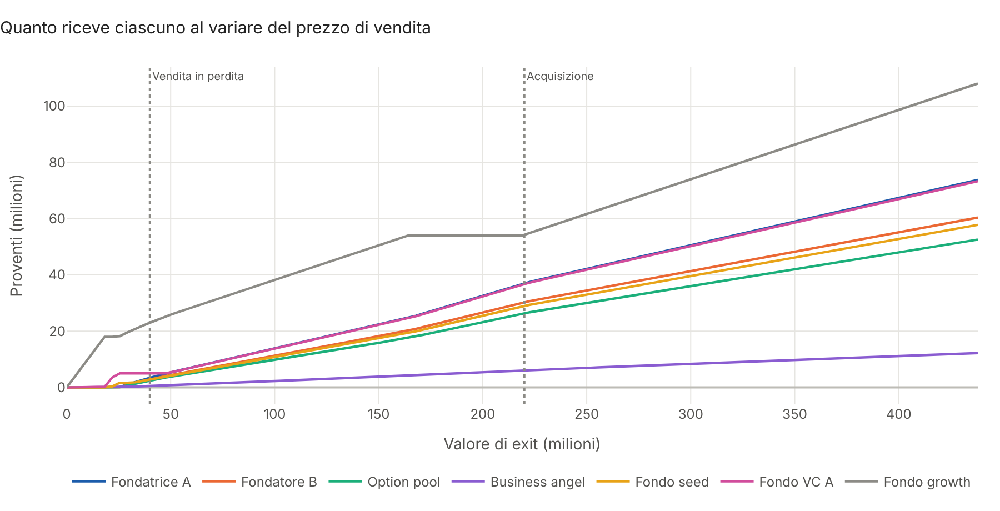
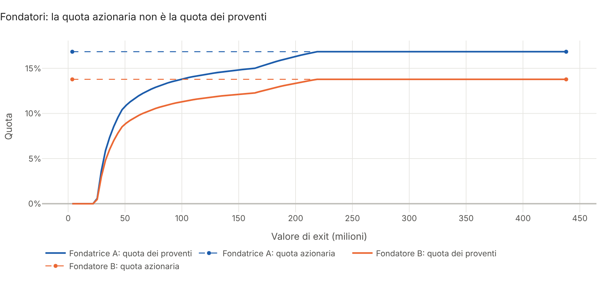
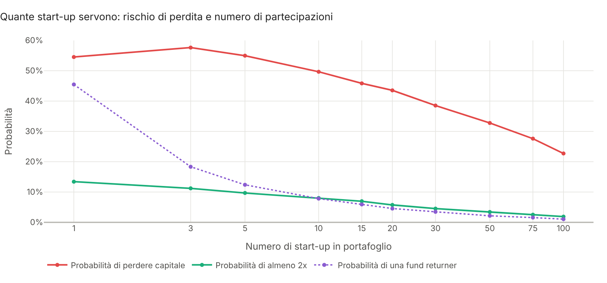
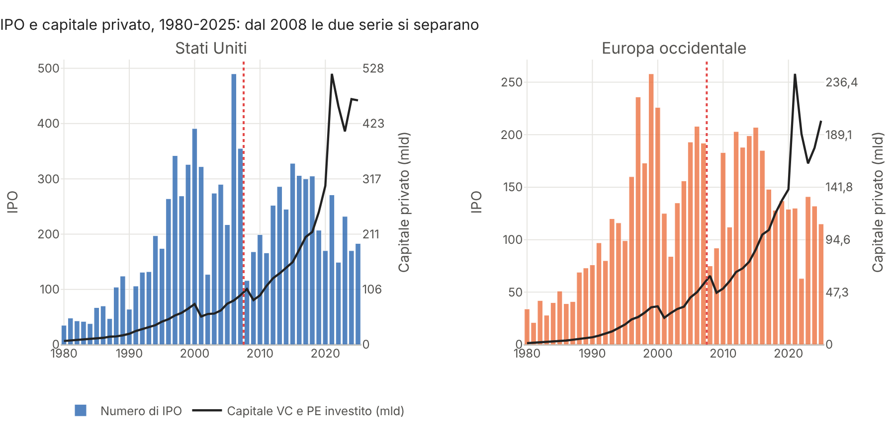
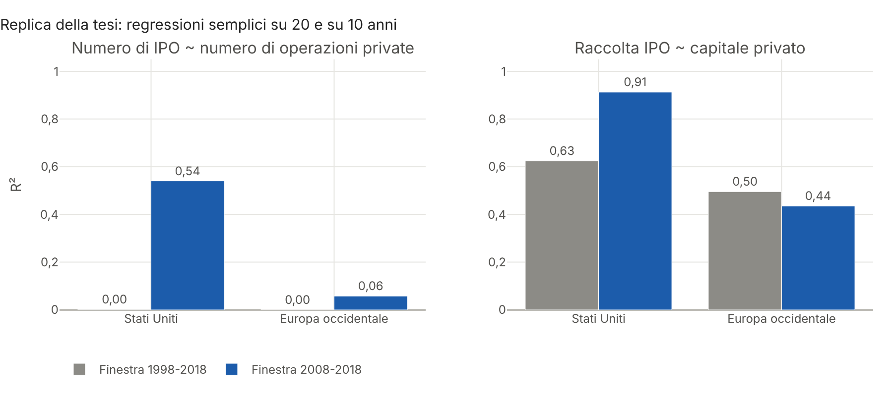
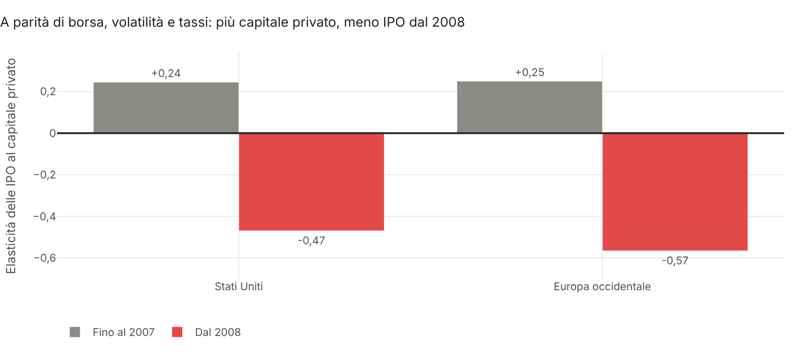
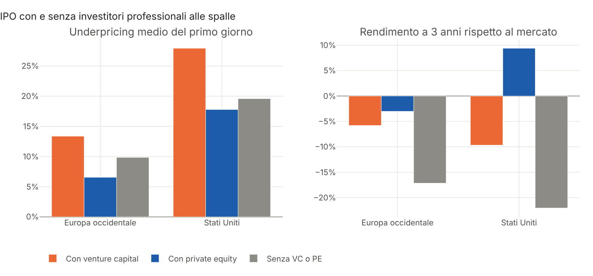

# Venture IPO Lab

**Dalla start-up alla quotazione, in Python: cap table e round, liquidation preference, valutazione, portafogli
angel, fondi di venture capital e un'analisi empirica del legame tra private market e IPO.**

Chi investe in una start-up deve rispondere a domande che un foglio Excel gestisce male. **Se la società viene
venduta, quanto riceve davvero ciascun socio? Quanto vale oggi un'azienda senza utili? Quante start-up servono per
non perdere capitale? Conviene passare da un fondo, e quanto tempo serve per vedere i soldi tornare?** E una domanda
più grande, da cui il progetto è partito: **l'abbondanza di capitale privato tiene le aziende lontane dalla borsa?**
Il risultato è un **report HTML interattivo** che segue un investimento dalla prima firma di un business angel fino
all'eventuale IPO.



## Da dove nasce

L'ultima sezione riprende e sviluppa la mia tesi di laurea magistrale in Banking & Finance all'USI (Università
della Svizzera italiana, 2019): *"Consequences of Venture Capital and Private Equity activities over the Initial
Public Offering procedures"*. La tesi misurava su quarant'anni di dati, in Europa occidentale e negli Stati Uniti,
il legame tra l'attività di VC e PE e il mercato delle IPO, con regressioni lineari semplici su 20 e su 10 anni.
Le conclusioni indicavano come passo successivo una regressione multivariata con i test F: questo progetto fa quel
passo e aggiunge il resto della catena, dal round seed all'exit.

I temi del progetto (venture capital, start-up dalla fase angel alla pre-IPO, accesso alla quotazione) sono gli
stessi su cui mi confronto in **Akka Italy**. Il progetto non usa dati, operazioni o partecipazioni di Akka Italy:
il caso, le serie e il campione di IPO dimostrativi sono sintetici.

## Cosa fa

| Area | Contenuto |
|---|---|
| **Cap table** | Fondatori, **SAFE post-money** con cap e sconto, round priced, **option pool shuffle** (il pool richiesto dagli investitori entra nel pre-money), quote fully diluted round per round |
| **Waterfall** | Liquidation preference 1x o più, **partecipanti e non**, tetto alla partecipazione, seniority *stacked* o *pari passu*; la scelta di convertire è un equilibrio tra le classi; soglia di conversione di ogni classe |
| **Valutazione** | **Metodo VC** (exit, multiplo o TIR obiettivo, diluizione futura) con tabella di sensitività, **First Chicago** sugli scenari di exit |
| **Portafoglio angel** | Rendimenti a **legge di potenza** (Beta per le perdite, Pareto troncata per i successi), simulazione Monte Carlo per 1-100 start-up, probabilità di perdita e di trovare una *fund returner*, concentrazione dei proventi, riserva per i **follow-on** |
| **Fondo VC** | Flussi di **Takahashi-Alexander** (Yale), **J-curve**, TVPI, DPI, RVPI, TIR, **PME di Kaplan-Schoar**, scenari per quartile, **piano di commitment** per arrivare a un'allocazione obiettivo |
| **IPO e private market** | **Replica** delle regressioni della tesi; **regressione multivariata** con valutazioni di borsa, volatilità e tassi (errori di Newey-West); **test F** sul ruolo del private market; **test di Chow** e ricerca dell'anno di rottura; età alla quotazione; **underpricing** e rendimento a 3 anni delle IPO con e senza VC o PE |
| **Report** | HTML in italiano con 14 grafici interattivi Plotly, tabelle e note di metodo |

Regressioni con `statsmodels`, simulazioni con `numpy`, test con `scipy`, grafici `plotly`, report `jinja2`.

## Avvio rapido

```bash
git clone https://github.com/Torraf-MI/venture-ipo-lab.git
cd venture-ipo-lab
pip install -e ".[png]"

# Report sul caso dimostrativo
venture-ipo-lab --demo

# Il proprio caso: fondatori, SAFE, round e scenari di exit in un file JSON
venture-ipo-lab --caso esempi/startup_demo.json --patrimonio 2000000 --allocazione 0.05

# Con dati reali sulle IPO (ad esempio un export Bloomberg) al posto di quelli sintetici
venture-ipo-lab --demo --serie mie_serie.csv --ipo mie_ipo.csv --offline --grafici output/grafici
```

Il report viene salvato in `output/report.html` (con `--offline` funziona anche senza connessione, con
`--grafici cartella` salva anche i PNG). Un esempio già generato: [`docs/report_esempio.html`](docs/report_esempio.html).

I formati dei CSV sono descritti in [`dati.py`](src/venture_ipo_lab/dati.py) e negli esempi in [`data/`](data/):
una riga per anno e regione per le serie (`anno, regione, ipo, ipo_raccolta, ipo_vc, ipo_pe, operazioni_private,
capitale_privato, eta_mediana_ipo, tasso_10a, valutazione, volatilita`) e una riga per IPO per il campione
(`anno, regione, backing, eta, raccolta, underpricing, rendimento_3a, mercato_3a`).

## Uso come libreria

```python
from venture_ipo_lab import CapTable, distribuisci, metodo_vc, simula_portafogli, flussi_fondo, indicatori
from venture_ipo_lab import genera_serie, prepara, ftest_privato, chow

ct = CapTable.fondazione({"Fondatrice": 0.6, "Fondatore": 0.4})
ct.safe("Business angel", 200_000, cap=2_500_000, sconto=0.2)
ct.round("Seed", 3_500_000, {"Fondo seed": 1_000_000}, pool_post=0.10)
ct.round("Serie A", 12_000_000, {"Fondo VC": 4_000_000}, pool_post=0.12, partecipante=True, cap_partecipazione=3)
print(ct.diluizione())                    # quote dopo ogni passaggio
print(distribuisci(ct, 20_000_000))       # chi riceve cosa con una vendita a 20 milioni

print(metodo_vc(150e6, 4e6, tir_target=0.40, anni=6, diluizioni_future=[0.2, 0.15]).come_serie())
print(simula_portafogli([5, 20, 50]))     # rischio di perdita e numero di start-up
print(indicatori(flussi_fondo()))         # TVPI, DPI, TIR del fondo

df = prepara(genera_serie(), "Europa occidentale")   # oppure carica_serie("file.csv")
print(ftest_privato(df), chow(df))       # il private market conta? il legame cambia nel 2008?
```

Esempio completo in [`examples/esempio.py`](examples/esempio.py).

## Risultati sul caso dimostrativo

Una start-up software inventata: due fondatori, un business angel con un SAFE da 250.000 € (cap 3 milioni), un
seed da 1,2 milioni, una Serie A da 5,5 milioni e una Serie B da 18 milioni con preference partecipante e tetto 3x.

**I fondatori possiedono il 31% delle azioni, ma non il 31% dei proventi.** In una vendita a 40 milioni, sotto il
post-money della Serie B, le preference passano davanti e ai fondatori va il 15% del prezzo. Il fondo della Serie B
recupera i 18 milioni e partecipa al resto. La quota dei proventi raggiunge quella azionaria solo quando ogni classe
preferisce convertire: per la Serie B, sopra 219 milioni.



**Valutazione.** Con il metodo VC, un'exit da 220 milioni, un obiettivo del 40% annuo su 6 anni (7,5x) e il 36% di
diluizione futura, chi investe 5,5 milioni deve chiedere il 29,5% (pre-money 13,1 milioni). Il First Chicago sui
quattro scenari, dal fallimento alla quotazione, dà un valore di 22,8 milioni.

**Portafoglio angel.** Nel modello il miglior 10% degli investimenti fa il 45% dei proventi. Con 10 start-up la
probabilità di perdere capitale è del 50%, con 50 del 33%, con 100 del 23%: il rendimento atteso non cambia, cambia
la probabilità di mancare l'unico caso che fa il risultato.



**Fondo.** Con una crescita del 14% annuo, il flusso cumulato dell'investitore scende fino a −79% del commitment e
torna positivo nell'ottavo anno, con un TVPI finale di 2,06x. Per tenere il 10% di un patrimonio di 5 milioni in
venture capital servono circa 79.000 € di commitment il primo anno, l'obiettivo si raggiunge in 9-10 anni e gli
impegni non ancora richiamati valgono un altro 3% del patrimonio.


### IPO e private market (dati sintetici)

> Le serie e il campione di IPO qui sotto sono **sintetici**: generati con un modello che ha ordini di grandezza
> simili alle statistiche pubbliche e relazioni note, per mostrare il metodo e tenere i test riproducibili. Non
> sono risultati sul mercato reale. Con un CSV di dati veri le stesse analisi girano senza modifiche.



**Passo 1, la replica.** Come nella tesi, la regressione semplice del numero di IPO sul numero di operazioni
private ha un R² quasi nullo su 1998-2018 e più alto su 2008-2018 (0,54 negli Stati Uniti).



**Passo 2, la multivariata.** A parità di valutazioni di borsa, volatilità e tassi, l'effetto del capitale privato
sulle IPO è positivo fino al 2007 (+0,25: crescono insieme) e diventa negativo dal 2008 (−0,47 negli Stati Uniti,
−0,57 in Europa): più capitale privato, meno quotazioni.



**Passo 3, i test.** Il test F rifiuta l'ipotesi che il private market non conti (F = 16,9 negli Stati Uniti e 45,1
in Europa, p < 0,001), e il test di Chow conferma la rottura del 2008. **Passo 4:** l'età mediana alla quotazione
cresce di circa 1,7 anni per decennio. **Passo 5:** le IPO con venture capital hanno più underpricing (+7 punti a
parità di età, dimensione, regione e anno), quelle con private equity meno, ed entrambe fanno meglio delle IPO senza
investitori professionali nei tre anni successivi.



## Metodo

- **Cap table.** Prezzo del round = pre-money / azioni fully diluted prima del round, comprese le azioni dei SAFE e
  l'ampliamento del pool, risolti insieme con un punto fisso. SAFE post-money: al cap, quota pari a importo / cap
  del capitale prima del round; con lo sconto, prezzo del round × (1 − sconto); vale il prezzo più basso.
- **Waterfall.** Preference pagate per seniority e pari passu a parità di seniority. Ogni classe convertibile
  sceglie tra preference e conversione con una risposta ottima iterata fino all'equilibrio. Partecipanti con tetto:
  l'eccedenza oltre il tetto si ridistribuisce agli altri. L'option pool è trattato come interamente assegnato.
- **Portafoglio.** Multiplo di una start-up: con probabilità 55% una Beta(0,6; 1,6) su [0, 1), altrimenti una
  Pareto troncata su [1, 250] con indice 1,75 (media 1,18x). Parametri modificabili in `DistribuzioneRendimenti`.
- **Fondo.** Takahashi e Alexander (2002): richiami come quota del non richiamato, distribuzioni `(t/L)^B` del NAV
  rivalutato. KS-PME di Kaplan e Schoar (2005). Piano di commitment a regime con patrimonio in crescita.
- **IPO.** OLS del log del numero di IPO su log del capitale privato, log delle valutazioni, volatilità, tasso a 10
  anni, dummy dal 2008 e interazione; errori di Newey-West con 2 ritardi. Test F annidato per il private market,
  test di Chow con ricerca dell'anno di rottura. Underpricing con effetti fissi per anno ed errori HC1; confronti con
  test t di Welch e Mann-Whitney.

## Struttura

```
src/venture_ipo_lab/
├── cap_table.py     # fondatori, SAFE, round, option pool, diluizione
├── waterfall.py     # liquidation preference e distribuzione dei proventi
├── valutazione.py   # metodo VC, First Chicago, sensitività
├── portafoglio.py   # legge di potenza, simulazioni, follow-on
├── fondo.py         # Takahashi-Alexander, J-curve, TVPI/DPI/PME, piano di commitment
├── ipo.py           # replica della tesi, multivariata, test F e di Chow, underpricing
├── dati.py          # dati dimostrativi e caricamento dei CSV
├── esempi.py        # caso dimostrativo e lettura dei casi JSON
├── report.py        # grafici e report HTML
└── cli.py           # riga di comando
```

## Test

```bash
pip install -e ".[dev]"
pytest -q          # 33 test: matematica dei round, waterfall, modelli, statistiche, report e CLI
ruff check src tests
```

La CI di GitHub Actions esegue test e lint su Python 3.11, 3.12 e 3.13.

## Avvertenze

Progetto dimostrativo a scopo didattico e di portfolio. Il caso, gli investitori, le serie storiche e le IPO del
report di esempio sono inventati. Non costituisce consulenza finanziaria, legale o fiscale: i termini reali di un
investimento (patti parasociali, clausole anti-diluizione, vesting, fiscalità) vanno verificati caso per caso.

## Licenza

MIT. Vedi [LICENSE](LICENSE).
